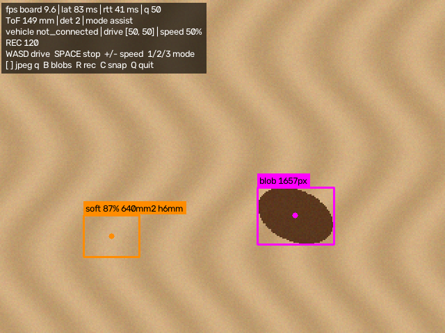

# nicla-tool

Arduino Nicla Vision에서 FOMO로 분변 중심을 찾고, ROI의 LAB 색상 보정으로 청소 영역을 추정하는 프로젝트.
현재 기준은 분변 전용 v1 모델이다. 노트북 뷰어와 재현용 학습·평가 도구를 제공하며,
모바일 청소 UI는 실제 보드 연결 전의 시뮬레이션이다.

개발 우선순위와 완료 기준은 [현재 로드맵](docs/roadmap.md)을 따른다.
소변 검출은 후속 단계이고, 굳기 분류·ToF 특징 결합은 선택적 확장으로 보류한다.


*노트북 뷰어 화면 예시. **실제 카메라 영상이 아니라 시뮬레이터가 그린 합성 이미지**입니다. 분홍 박스는 1단계 데모 색상 검출(학습 모델 아님)을 그 합성 이미지에 돌린 결과이고, 주황 박스는 4단계 굳기 판정이 어떻게 표시될지 보여 주려고 값을 직접 넣은 예시입니다.*

## 구조

```
노트북 (viewer.py)  ◄── Wi-Fi: 영상 + 인식 결과 ──  Nicla Vision (stream_server.py)
                    ──  조종 명령 ──────────────►        │ (예정) UART
                                                        ▼
                                                    차량 아두이노
```

| 폴더 | 내용 |
|---|---|
| `nicla/` | 보드용 MicroPython (OpenMV 펌웨어). 신·구 카메라 API 모두 지원 |
| `laptop/` | 노트북용 Python: 측정 기록, 분석, 캘리브레이션, 뷰어, 보드 시뮬레이터 |
| `tests/` | 보드 모듈을 흉내 내 보드 스크립트까지 PC에서 검증하는 테스트 |
| `docs/` | [1단계 실험 절차](docs/phase1.md), [준비물](docs/parts.md), [인식 구조](docs/architecture.md), [통신 규약](docs/protocol.md) |
| `datasets/` | FOMO 데이터와 필요 시 ROI 세그멘테이션 데이터를 준비하는 작업 공간 |
| `models/` | FOMO 모델 배포 방법과 로컬 모델 보관 위치 |
| `results/` | 측정 결과 (git에 올림) |

## 빠른 시작 (보드 없이)

```
py -m pip install -r laptop\requirements.txt
py laptop\fake_nicla.py                      # 창 1: 가짜 보드
py laptop\viewer.py --host 127.0.0.1         # 창 2: 뷰어
```

실제 Nicla를 USB로 연결해 Wi-Fi 전환 없이 카메라 화면을 확인하려면
`nicla/usb_preview.py`를 보드 드라이브에 복사한 뒤 실행한다.

```powershell
.\.venv\Scripts\python.exe laptop\usb_viewer.py
```

미리보기 창에서 `C`는 현재 프레임 저장, `Q` 또는 `Esc`는 종료다.

## 진행 단계

| 단계 | 내용 | 상태 |
|---|---|---|
| 1 | 분변 FOMO 학습·평가 재현 | v1 모델, 195장 개발 데이터, 독립 평가 15장 포함 |
| 2 | FOMO → ROI-LAB → 3/5 프레임 합의 | 구현됨. 실제 보드 성능·영역 커버리지 검증 필요 |
| 3 | 실제 장착 조건·강한 음성·주행 데이터 평가 | 다음 우선순위 |
| 4 | 모바일 UI와 로컬 브리지 연결 | UI 데모만 구현, 브리지 미구현 |
| 5 | 차량 UART·워치독·자율 정지·청소 동작 | 미구현. 차량 명령은 현재 상태만 기록 |
| 6 | LED 차분 기반 소변 검출 | 실험 통과 후 데이터 수집·학습·통합 |
| 후속 | 굳기 분류, ToF·면적 특징 결합 | 현재 v1 필수 범위에서 제외, 필요 시 재개 |

[1단계 하드웨어 실험](docs/phase1.md)은 송출·ToF·LED 검증 절차로 유지한다.
실험 결과가 저장소에 없다는 것은 실패나 성공을 의미하지 않는다.

## TinyML + ROI 실행

현재 FOMO는 `stool` 중심을 찾고, 중심 주변 ROI에서 청소 영역을 추정한다.
`urine` 경로는 후속 모델을 위한 준비 코드이며 현재 모델에는 포함되지 않는다. 모델이 설치되지 않은 `auto`
모드에서는 기존 LAB 데모 검출로 폴백하므로, 뷰어 HUD의 detector 이름을
반드시 확인한다. 수집 조건과 색상 검출/세그멘테이션 전환 기준은
[TinyML + ROI 가이드](docs/tinyml_roi.md)에 정리돼 있다.

실행 중에는 뷰어의 `O`로 ROI 보정, `T`로 3/5 프레임 합의 필터를 켜고
끌 수 있다. `P`는 FOMO 파이프라인과 기존 색상 데모를 비교한다. 기본 운용은
`fomo_roi + ROI on + temporal on`이며 전환 상태는 녹화 메타데이터에 남는다.

## 재현용 분변 FOMO v1

학습·평가에 필요한 최종 데이터만
[`datasets/stool_public/v1`](datasets/stool_public/v1/README.md)에 독립적으로
정리했다. 학습 원본 195장과 최종 mask·label, 학습에 사용하지 않은 독립 평가
15장, SHA-256 체크섬과 데이터 카드를 포함한다. 중간 AI 결과, 미리보기,
검수 백업, checking 중복 사본은 포함하지 않는다.

Windows PowerShell에서 다음 명령으로 환경 구성부터 최종 모델·평가 결과까지
재현할 수 있다.

```powershell
.\setup_training_windows.ps1
.\reproduce_stool_v1.ps1
```

`none`, `mild`, `default` 증강을 6개 분변 집단에 대해 모두 6-fold로 비교하려면:

```powershell
.\reproduce_stool_v1.ps1 -RunCrossValidation
```

재현 스크립트는 데이터 체크섬을 먼저 검증하고 공개 데이터는 수정하지 않는다.
모든 생성물은 Git에서 제외된 `training_runs/<실행명>/`에 저장된다. 기준 모델과
평가값은 각각 `models/fomo_stool_v1.tflite`와
`reports/stool_fomo_v1_reference.json`에 있다.
