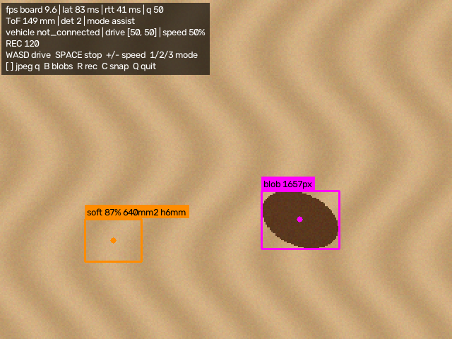

# nicla-tool

Arduino Nicla Vision으로 바닥의 분변을 찾고 굳기(점성)를 판별해, 노트북 화면에 표시하고 원격 조종까지 하는 프로젝트.


*노트북 뷰어 화면 (시뮬레이터). 분홍 = 1단계 데모 색상 검출, 주황 = 4단계에서 붙을 굳기 판정 표시 예시*

## 구조

```
노트북 (viewer.py)  ◄── Wi-Fi: 영상 + 인식 결과 ──  Nicla Vision (stream_server.py)
                    ──  조종 명령 ──────────────►        │ (예정) UART
                                                        ▼
                                                    차량 아두이노
```

| 폴더 | 내용 |
|---|---|
| `nicla/` | 보드용 MicroPython (OpenMV 펌웨어). 신·구 카메라 API 모두 지원 |
| `laptop/` | 노트북용 Python: 측정 기록, 분석, 캘리브레이션, 뷰어, 보드 시뮬레이터 |
| `tests/` | 보드 모듈을 흉내 내 보드 스크립트까지 PC에서 검증하는 테스트 |
| `docs/` | [1단계 실험 절차](docs/phase1.md), [통신 규약](docs/protocol.md) |
| `results/` | 측정 결과 (git에 올림) |

## 빠른 시작 (보드 없이)

```
py -m pip install -r laptop\requirements.txt
py laptop\fake_nicla.py                      # 창 1: 가짜 보드
py laptop\viewer.py --host 127.0.0.1         # 창 2: 뷰어
```

## 진행 단계

| 단계 | 내용 | 상태 |
|---|---|---|
| 1 | 하드웨어 검증: 장착 기하, ToF 판별력, 노출 고정, Wi-Fi 송출 | **진행 중** → [docs/phase1.md](docs/phase1.md) |
| 2 | 모사체 데이터 수집 (뷰어 녹화 기능 사용) | |
| 3 | 학습: FOMO 검출 + MobileNetV2 굳기 분류(+ToF 특징) | |
| 4 | 보드 배포, 인식 결과 오버레이, 자율 정지 | |
| 5 | 실환경 평가 (정확도, 종단 지연, 정지 거리) | |

차량 제어는 차량 쪽 코드가 정해지면 `nicla/stream_server.py`의 `vehicle_send()`에 연결한다.
