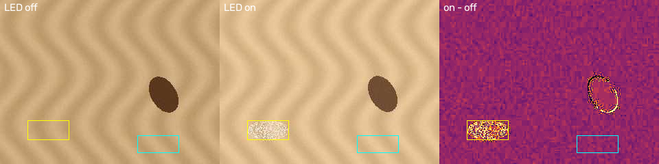

# 1단계: 하드웨어 검증

목표: 학습을 시작하기 전에 **이 하드웨어로 무엇을 잴 수 있는지** 판정한다.
결과에 따라 2단계 데이터 수집 방식(ToF 사용 여부, 장착 위치, 카메라 설정)이 확정된다.

| 작업 | 질문 | 도구 | 판정 기준 |
|---|---|---|---|
| 1-1 환경 | 보드·노트북이 준비됐나 | OpenMV IDE, `pip install` | 모든 스크립트 실행됨 |
| 1-2 장착 기하 | 바닥이 얼마나 보이고 1px이 몇 mm인가 | `viewer.py` + `calibrate.py` | FOMO 칸 1개 ≤ 15 mm |
| 1-3 ToF | 5 mm 높이 차이를 구분하나 | `tof_logger.py` + `capture.py` + `analyze_tof.py` | d' ≥ 3 |
| 1-4 노출 | 조명 고정 시 밝기가 안정적인가 | `exposure_test.py` + `analyze_exposure.py` | 10분 변동 ≤ 5% |
| 1-5 Wi-Fi | 노트북으로 몇 fps, 지연 얼마로 오나 | `stream_server.py` + `viewer.py` | ≥ 8 fps, 지연 p95 ≤ 300 ms |
| 1-6 젖은 바닥 | 오줌 웅덩이가 카메라에 보이나, 어떤 단서로 | `viewer.py --illum alt` + `wet_analyze.py` | 차분 d' ≥ 3, 주변 조명 바꿔도 유지 |

차량 제어(UART)는 차량 쪽 보드가 정해진 뒤 추가한다. 지금은 명령이 보드까지 도착하는지(ack)만 확인한다.

---

## 1-1. 환경 준비 (한 번만)

1. **OpenMV IDE** 설치 → Nicla 연결 → IDE가 펌웨어 업데이트를 제안하면 진행 (OpenMV 펌웨어가 아니면 여기서 설치됨)
2. 노트북에서:
   ```
   git clone https://github.com/SuyongHuh1/nicla-tool
   cd nicla-tool
   py -m pip install -r laptop\requirements.txt
   py -m pytest -q tests          # 16 passed 이면 정상
   ```
3. 보드 드라이브(USB로 연결하면 보이는 디스크)에 `nicla\camlib.py`, `nicla\nvproto.py` 복사
4. `nicla\wifi_config_example.py`를 `wifi_config.py`로 복사해 핫스팟 이름/비밀번호 입력 후 보드 드라이브에 복사
   - **노트북 모바일 핫스팟(2.4 GHz)** 추천. 학교 Wi-Fi(학번 로그인)는 안 됨
   - 안테나(U.FL)를 보드 J6에 꼭 연결

**스크립트 실행 방법 두 가지**
- 화면만 볼 때: OpenMV IDE에서 열고 ▶ 실행
- `capture.py`로 기록할 때: IDE에서 *Tools → Save open script to OpenMV Cam (as main.py)* → **IDE 종료** → 보드 리셋 버튼. (IDE가 켜져 있으면 COM 포트를 점유함)

## 1-2. 장착 기하 (calibration)

1. 체스보드 인쇄: `py laptop\calibrate.py board` → `results\calib\chessboard_9x7_20mm.pdf`를 **실제 크기(100%)**로 인쇄, 50 mm 막대를 자로 확인
2. 카메라를 실제 장착 위치에 고정. 아래 조합마다 반복 (라벨 예: `floor_h120_t45`)
   - 높이: 실제 장착 높이 1개 + 위아래 1개씩
   - 하향 각도: 2종 (예: 30°, 45°)
3. 체스보드를 카메라 앞 바닥에 평평하게 놓고 `stream_server.py` 실행 → `py laptop\viewer.py --host <IP> --label floor_h120_t45` → **C** 키로 저장
4. `py laptop\calibrate.py floor captures\floor_h120_t45_*.jpg`
   - 출력: 화면 아래/가운데/위의 mm/px, 보이는 바닥 폭·깊이, **FOMO 칸 1개의 실제 크기**
   - `results\calib\floor_*_check.png`에 10 mm 격자가 체스보드와 맞으면 성공
5. (선택) 렌즈 왜곡이 크면: 체스보드를 여러 각도로 15장 찍어 `calibrate.py intrinsics captures\cal_*.jpg` → floor에 `--intrinsics results\calib\intrinsics.json`

**판정**: 분변 크기(지름 20~40 mm)를 생각하면 FOMO 칸 1개가 15 mm 이하여야 검출이 안정적. 넘으면 카메라를 낮추거나 각도를 키움.

## 1-3. ToF 판별력 (핵심 실험)

**준비물**: 높이 5 / 10 / 20 / 30 mm 블록을 두 가지 면적(약 30×30 mm, 60×60 mm)으로. 지우개, 레고, 골판지 적층 등. 바닥과 비슷한 색이면 더 좋음.

**블록 위치**: 카메라 화면 정중앙(ToF는 카메라 옆에서 같은 방향을 봄). viewer에서 ToF 값이 변하는 위치를 먼저 확인.

보드에 `tof_logger.py`를 main.py로 저장한 뒤, 조건마다:
```
py laptop\capture.py --kind tof --label h00_b00_t45            # 바닥만 (기울기마다 1번)
py laptop\capture.py --kind tof --label h05_b30_t45
py laptop\capture.py --kind tof --label h10_b30_t45
py laptop\capture.py --kind tof --label h20_b30_t45
py laptop\capture.py --kind tof --label h30_b30_t45
py laptop\capture.py --kind tof --label h05_b60_t45
...  (b60도 동일)
```
라벨 규칙: `h<높이mm>_b<블록mm>_<태그>`. 태그는 장착 조건(기울기·높이). 같은 태그끼리 비교된다.

분석:
```
py laptop\analyze_tof.py --tilt-deg 45
```
→ `results\tof\verdict.md`, `summary.png`

**판정**
- **PASS**: 5 mm 간격의 모든 쌍에서 d' ≥ 3 → ToF 높이를 모델 B 특징으로 사용
- **조건부**: 60 mm 블록만 통과 → ToF 측정 영역이 작은 물체보다 큼. 근거리 장착 또는 ROI 축소(전체 ST 드라이버 필요) 검토
- **FAIL**: 라인 레이저 삼각측량으로 전환

참고: VL53L1X 시야각은 약 27°. 거리 100 mm에서 측정 영역 지름 약 48 mm, 기울이면 앞뒤로 더 길어짐. `verdict.md`에 조건별 측정 영역 크기가 계산되어 나온다.

## 1-4. 조명·노출 고정

보조 LED를 켠 상태로 `exposure_test.py`를 main.py로 저장:
```
py laptop\capture.py --kind exposure --label lock_led --seconds 600
```
비교용으로 파일 상단 `LOCK = False`로 바꿔 한 번 더 (`--label auto_led`). 주변 조명을 일부러 바꿔 보면(형광등 끄기 등) 차이가 잘 보인다.
```
py laptop\analyze_exposure.py
```
**판정**: LOCK 조건에서 변동 ≤ 5%, 노출값 고정 유지. 실패 시 LED 밝기를 올리고 노출 시간을 짧게 고정.

## 1-5. Wi-Fi 송출

`stream_server.py`를 main.py로 저장 (camlib.py, nvproto.py, wifi_config.py 함께). OpenMV IDE 시리얼 터미널에 `stream_server ready: <IP>:5005`가 표시됨 (핫스팟 연결 기기 목록에서도 확인 가능).

JPEG 품질별로 60초씩:
```
py laptop\viewer.py --host <IP> --label wifi_q30 --jpeg-q 30 --duration 60
py laptop\viewer.py --host <IP> --label wifi_q50 --jpeg-q 50 --duration 60
py laptop\viewer.py --host <IP> --label wifi_q70 --jpeg-q 70 --duration 60
```
→ `results\stream\wifi_q*.json` (fps, 지연 p50/p95, 왕복시간)

화면 확인: 갈색 물체를 놓으면 분홍 박스(데모 색상 검출)가 표시되어야 함. 안 잡히면 OpenMV IDE의 *Tools → Machine Vision → Threshold Editor*로 `BLOB_LAB` 값을 조정.
조종 키(WASD)를 누르면 HUD의 `drive` 값이 바뀌어야 함 (보드까지 명령 도착 확인).

**판정**: 8 fps 이상, 지연 p95 300 ms 이하인 품질 중 가장 높은 값 채택. 미달이면 QQVGA(160×120) 송출 검토.

## 1-6. 젖은 바닥(오줌) 가시성

**문제**: 오줌은 색 대비가 약하고 높이가 없어서, 일반 카메라에는 주로 **빛 반사**로만 보인다. 반사는 주변 조명에 크게 좌우된다.
**해결 아이디어**: 보조 LED를 프레임마다 켜고 끈다. 주변광은 두 프레임에 똑같이 들어가므로 `켬 − 끔`을 빼면 **우리 LED가 만든 빛만 남는다**. 젖은 막은 LED를 반짝 반사(정반사)하고, 마른 바닥은 고르게 조금 밝아질 뿐이다.


*시뮬레이터 예시: 왼쪽(LED 끔)에선 노란 박스 안 웅덩이가 거의 안 보이고, 오른쪽 차분 영상에선 뚜렷하다. 움직이는 물체는 차분 영상에서 테두리가 생긴다(아래 "움직임" 참고).*

### 준비물

| 부품 | 용도 | 비고 |
|---|---|---|
| 고휘도 백색 LED 모듈 (1~3 W) | 보조 조명 | 렌즈 옆, 바닥을 비스듬히 비추도록 |
| 로직레벨 N-MOSFET (예: AO3400, IRLZ44N) + 저항 100 Ω / 10 kΩ | 보드 핀으로 LED 켜고 끄기 | **D0 핀은 수 mA만 나옴. LED 직결 금지** |
| 선형 편광 필름 2장 | 반사 강조 (선택) | LED 앞 1장, 카메라 렌즈 앞 1장 |
| 물 + 노란 식용색소, 스포이트 | 모사 소변 | 웅덩이 지름 3~8 cm |
| 바닥재 2종 이상 | 장판/마루, 흰 타일 | |

배선: `D0 → 100 Ω → MOSFET 게이트`, `게이트 → 10 kΩ → GND`, `LED(+) → 5 V (Nicla가 아닌 별도 전원: 차량 배터리 레귤레이터 등)`, `LED(−) → MOSFET 드레인`, `소스 → GND`. LED 모듈에 전류 제한이 없으면 직렬 저항 필요. Nicla GND와 LED 전원 GND는 공통으로.

### 보드 설정 (`stream_server.py` 상단)
- `ILLUM_PIN = "D0"` (D1/D2는 나중에 차량 UART용으로 비워 둠)
- `LOCK_WITH_ILLUM = True`: LED 켠 상태로 노출을 정해서 켠 프레임이 하얗게 날아가지 않게 함
- `FLICKER_SAFE = True`: 노출 시간을 형광등·LED 조명 깜빡임 주기(8.33 ms)의 정수배로 맞춤. 이게 꺼져 있으면 실내 조명 깜빡임이 차분 영상에 줄무늬 노이즈로 남음

### 절차
조건마다 카메라와 웅덩이를 **고정한 채로** 10초 녹화:
```
py laptop\viewer.py --host <IP> --illum alt --record --duration 10 --label wood_water_room
```
뷰어에서 **V** 키를 누르면 차분 영상을 실시간으로 볼 수 있다. 웅덩이가 밝게 떠야 정상.

| 조건 | 바닥 | 액체 | 주변 조명 | LED 각도 | 편광 |
|---|---|---|---|---|---|
| 기본 | 마루, 타일 | 노란 물 | 실내등 켬 | 30°, 60° | 없음 |
| 조명 강건성 | 마루 | 노란 물 | **끔 / 켬 / 창가 햇빛** | 좋았던 각도 | 없음 |
| 편광 | 마루 | 노란 물 | 실내등 | 좋았던 각도 | 있음 |
| 마른 얼룩 | 마루 | 물 마른 자국 | 실내등 | 좋았던 각도 | 좋았던 쪽 |
| 대조군 | 마루 | **없음** | 실내등 | 좋았던 각도 | 좋았던 쪽 |

라벨 예: `wood_water_room_a30`, `wood_water_dark_a30`, `tile_water_sun_a60_pol`, `wood_none_room_a30`

분석 (처음 한 번은 마우스로 영역 지정, 이후 같은 값 재사용):
```
py laptop\wet_analyze.py recordings\<폴더> --select
py laptop\wet_analyze.py recordings\<폴더> --wet x,y,w,h --dry x,y,w,h
```
→ `results\wet\summary.md`: 조건별로 5가지 단서(LED 끔 밝기, 노란색, LED 켬 밝기, 차분, 정규화 차분)의 d'와 커버리지

### 판정
- **채택**: 차분 d' ≥ 3이 **세 가지 주변 조명 모두에서** 유지되고, 대조군(웅덩이 없음)에선 그 영역이 안 뜸 → 2단계에서 "액체" 클래스 데이터 수집
- **조건부**: 타일에서만 보이거나 특정 LED 각도에서만 보임 → 시연 바닥을 한정하거나 편광 추가
- **포기/대안**: 어디서도 d' < 1.5 → 카메라로는 어려움. 열화상 센서(갓 눈 오줌만) 등 별도 센서 검토
- 경고 "settle을 올려라"가 나오면 LED 전환과 촬영 사이 지연 때문: 뷰어 실행 중 `ILLUM_SETTLE`을 2로

### 움직임 주의
차분은 두 프레임 사이에 카메라나 물체가 움직이면 테두리가 생긴다(위 그림의 갈색 물체). 1-6은 정지 상태에서만 측정하고, 주행 중 적용 방법(정렬 보정, 저속 구간에서만 판단)은 4단계에서 다룬다. → [architecture.md](architecture.md)

---

## 결과 전달

`results\` 폴더를 git으로 올리면(`git add results && git commit -m "phase1 results" && git push`) 분석·판정을 이어서 진행한다. 녹화 영상(`recordings\`)은 용량이 커서 git에서 제외되어 있으니 필요하면 Google Drive로.
